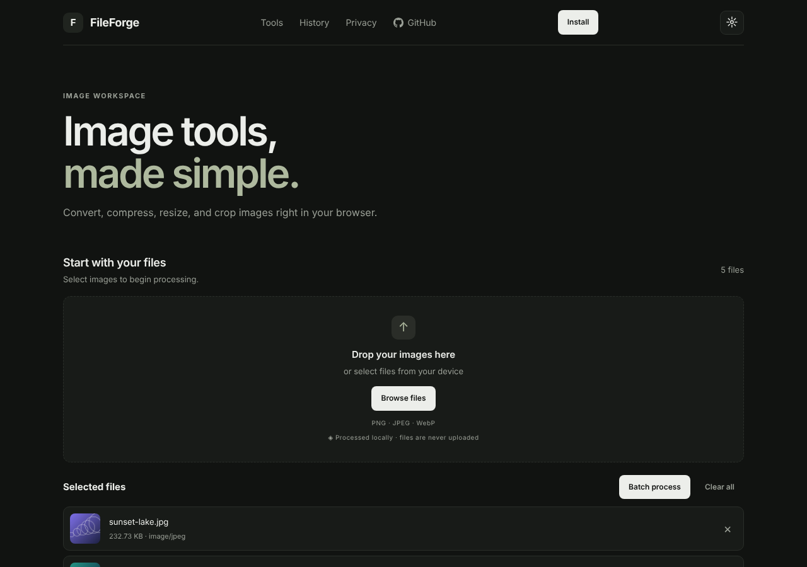
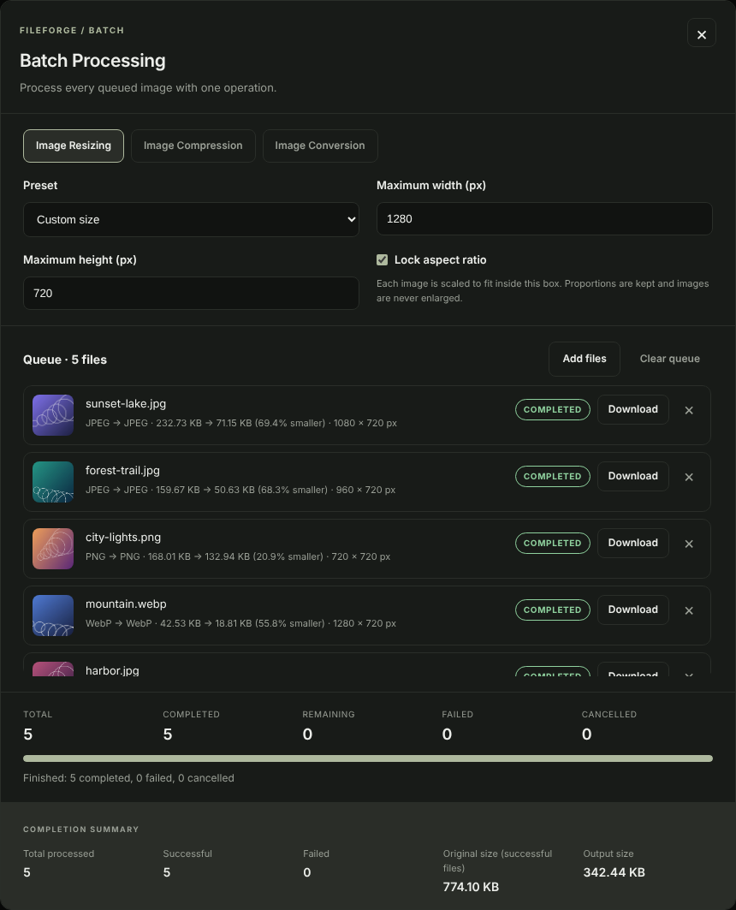
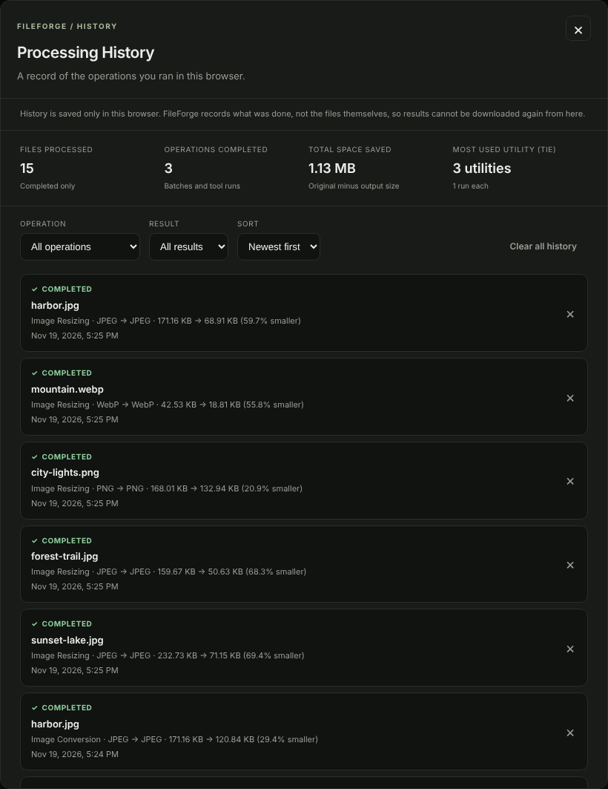
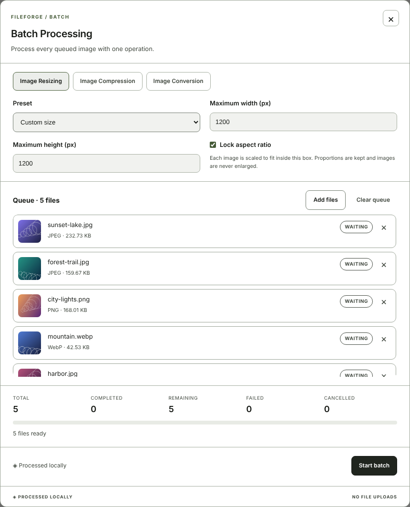
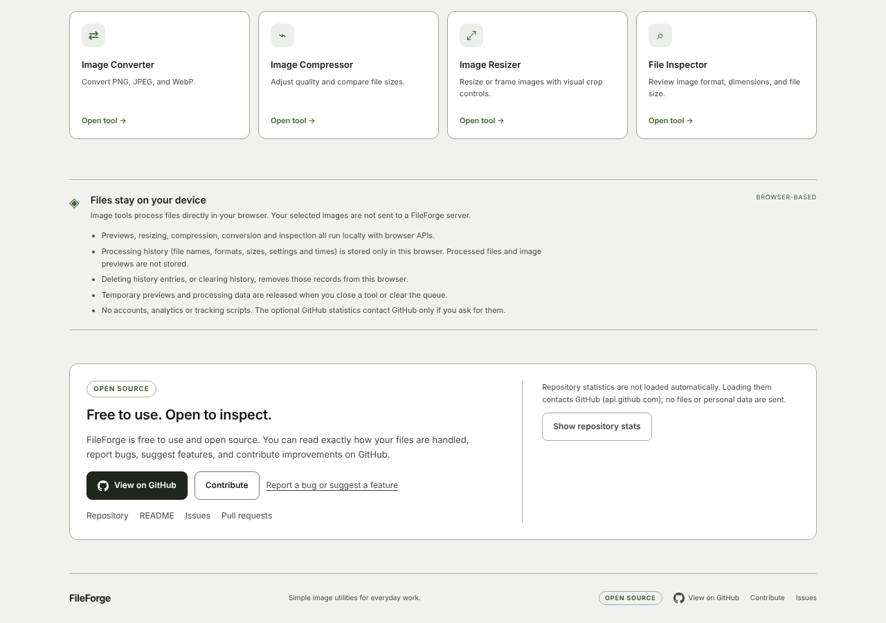

<div align="center">

# FileForge

**Image tools that keep processing in your browser.**

Convert, compress, resize, crop, and inspect PNG, JPEG, and WebP images, one at a time or in batches, with nothing uploaded.

[](https://developer.mozilla.org/en-US/docs/Web/JavaScript) [](https://vite.dev/)

</div>



## Features

| Tool | Capabilities |
| --- | --- |
| **Batch processing** | Run one operation (resize, compress, or convert) over every queued image. Controlled concurrency, live per-file status, overall progress, cancel, individual downloads, a ZIP download, and a completion summary. |
| **Converter** | Convert between PNG, JPEG, and WebP. Adjust quality for JPEG and WebP output. |
| **Compressor** | Keep the source format or choose PNG, JPEG, or WebP. Compare output sizes and download results (individually or as a ZIP). |
| **Resizer** | Fit images within maximum dimensions or open a visual crop editor with draggable framing, aspect ratios, rectangle or circle crops, output dimensions, and format/quality settings. |
| **Inspector** | View file type, size, last-modified time, dimensions, aspect ratio, and pixel count. |
| **Processing history** | A local record of what you processed: file name, operation, formats, sizes, settings, time, and result, with filters, sorting, details, deletion, and statistics. |

### Batch processing

Select or drag and drop images; the same list is your batch queue. Click **Batch process**, choose an operation, adjust its settings, and start.

- **Resizing:** custom width and height, a lockable aspect ratio, and presets (HD, Full HD, Square, Thumbnail). With the ratio locked, each image is scaled to fit inside the box and is never enlarged.
- **Compression:** quality, output format (or keep each file's format), and an optional target file size for JPEG and WebP. The target is met by lowering quality (never below 10%); if it cannot be met, the file is marked "target size not reached". PNG is lossless, so quality and target do not apply.
- **Conversion:** PNG, JPEG, or WebP output. Formats your browser cannot encode are disabled.
- Statuses are **Waiting**, **Processing**, **Completed**, **Failed**, and **Cancelled**. Progress is calculated from the real status of each file. One failing file never stops the others.
- Output files are named like `photo-resized.jpg`, `photo-compressed.webp`, or `photo.webp`. If two outputs would share a name, the second becomes `name (2).ext`.

### Processing history

History is stored in your browser's IndexedDB and survives refreshes and restarts. It stores **metadata only**: names, formats, sizes, settings, timestamps, and results. It does **not** store your images, processed files, or previews, so an old result cannot be downloaded again from history. Statistics (files processed, operations completed, space saved, most used utility) count only completed work; failed and cancelled files are listed but not counted. The most recent 1,000 records are kept.

## Screenshots

These are real screenshots of the application, taken with generated sample images.

| Batch processing (dark) | Processing history (dark) |
| --- | --- |
|  |  |

| Batch queue ready to start (light) | Privacy and open-source sections (light) |
| --- | --- |
|  |  |

## Install on Android or desktop

FileForge is an installable web app. On Android and supported desktop browsers, use the **Install** button when it appears or choose the browser's install option. The app shell is cached for repeat launches and offline use after the first online visit. The cache holds the application's own files only, never your images.

## Technology stack

- Vanilla JavaScript (ES modules) and browser APIs: File, Blob, Canvas, `createImageBitmap`, `URL.createObjectURL`, and IndexedDB
- CSS
- [Vite](https://vite.dev/) for development and builds
- Node's built-in test runner (`node --test`) for unit tests
- No framework and no runtime dependencies

## Run locally

**Requirements:** Node.js 20.19+ or 22.12+.

```bash
git clone https://github.com/kyxzu/FileForge.git
cd FileForge
npm ci
npm run dev
```

Open the local URL printed by Vite.

| Command | What it does |
| --- | --- |
| `npm run dev` | Start the development server |
| `npm test` | Run the unit tests |
| `npm run build` | Create the production build in `dist/` |
| `npm run preview` | Serve the production build locally |

## Privacy

- **Local processing:** selection, validation, inspection, previews, conversion, compression, resizing, cropping, batch processing, and ZIP creation all run in your browser. The application code does not upload your files anywhere and there is no FileForge server to receive them.
- **What is stored:** the theme preference (local storage), processing history metadata (IndexedDB), and, only if you click the button, a cached copy of public GitHub repository statistics (local storage). Clearing history or deleting an entry removes those records from your browser. History persists until you delete it; closing the tab does not erase it.
- **Temporary data:** image previews and processing data are held in memory and released (object URLs revoked, decoded bitmaps closed, canvases emptied) when you close a tool, clear the queue, or cancel.
- **No tracking:** no accounts, analytics, telemetry, or tracking scripts.
- **Network use:** the only optional request is the GitHub statistics button, which calls the public GitHub API (`api.github.com`) and sends no files or personal data. Nothing is requested until you click it.
- **Production safeguard:** production builds include a Content-Security-Policy that restricts connections to the app's own origin and `https://api.github.com`, so the browser itself refuses other network requests.
- **File checks:** files are checked for size (50 MB max), type, extension, file signature (the actual contents must match), and image dimensions (100 megapixels max) before they are accepted. Filenames are rendered as text, never as HTML, and downloads use sanitized names.

## Deployment

A GitHub Actions workflow (`.github/workflows/deploy.yml`) runs the tests, builds the app with the `/FileForge/` base path, and publishes it to GitHub Pages on every push to `main`. To enable it once, open **Settings → Pages** in the repository and set **Source** to **GitHub Actions**. The site is then served at `https://kyxzu.github.io/FileForge/`.

## Project structure

```
FileForge/
├── index.html                # Page shell
├── vite.config.js            # Vite config (adds the CSP to production builds)
├── public/                   # Icons, web manifest, service worker
├── docs/screenshots/         # Screenshots used in this README
├── src/
│   ├── main.js               # Entry point, install button, service worker
│   ├── app.js                # Page layout, theme, upload queue, existing tools
│   ├── lib/                  # Logic without UI
│   │   ├── imageProcessing.js  # Convert, compress, resize (Canvas)
│   │   ├── operations.js       # Batch operations, settings validation
│   │   ├── batchQueue.js       # Queue with controlled concurrency and cancel
│   │   ├── history.js          # IndexedDB history and statistics
│   │   ├── files.js            # Validation, safe filenames
│   │   ├── download.js         # Downloads and ZIP creation
│   │   ├── github.js           # Repository links and optional stats
│   │   └── ...                 # format, dom, toast, runRecorder
│   ├── ui/                   # Dialogs: batch, history, confirm, open-source
│   └── styles/               # styles.css (original) and features.css
└── tests/                    # Unit tests (node --test)
```

`src/counter.js` and the images in `src/assets/` come from the Vite starter template and are not used by the app.

## Contributing

Contributions are welcome. Please read [CONTRIBUTING.md](CONTRIBUTING.md) for setup, code expectations, and how to report bugs or suggest features. You can [open an issue](https://github.com/kyxzu/FileForge/issues/new/choose) or submit a [pull request](https://github.com/kyxzu/FileForge/pulls).

## License

This repository does not currently include a license file, so no license has been granted. The repository owner will add one when they choose it.
